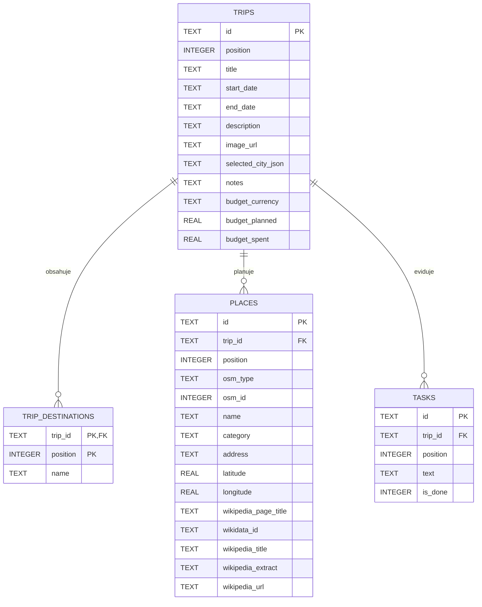

# Databázový návrh

## Zvolená technologie

Pro desktopovou aplikaci je použita SQLite přes balíček `Microsoft.Data.Sqlite`.
Databázový soubor `itineraries.db` se vytváří v aplikačním datovém adresáři MAUI,
proto jeho instalace nevyžaduje samostatný databázový server ani další instalátor.
Přístup k databázi zajišťuje .NET část aplikace; Angular komunikuje s MAUI přes
asynchronní WebView bridge.

V desktopové verzi lze umístění databáze zobrazit a otevřít tlačítkem
„Databáze“ v horní liště aplikace.

## ER diagram

## Omezení a integrita

- Odstranění itineráře odstraní také jeho destinace, místa a úkoly (`ON DELETE CASCADE`).
- Pořadí destinací, míst a úkolů je uloženo ve sloupci `position`.
- OSM objekt je v rámci jednoho itineráře jednoznačný podle typu a OSM ID.
- Změna itineráře a přepsání jeho podřízených záznamů probíhá v jedné transakci.
- Verze schématu je evidována pomocí `PRAGMA user_version`; nové změny schématu
  se budou přidávat jako navazující migrace.
- Tabulka `TRIPS` uchovává také krátký popis projektu a URL titulního obrázku.
- Tabulka `TRIPS` uchovává vybrané město včetně geografického ohraničení a článku
  Wikipedie jako JSON; jeho hranice se používají k omezení hledání míst.
- Při prvním otevření databáze se existující data z `localStorage` jednorázově
  importují. Původní data se odstraní z `localStorage` až po úspěšné odpovědi databáze.
- Migrace schématu z verze 2 přidá uložené vybrané město projektu.
